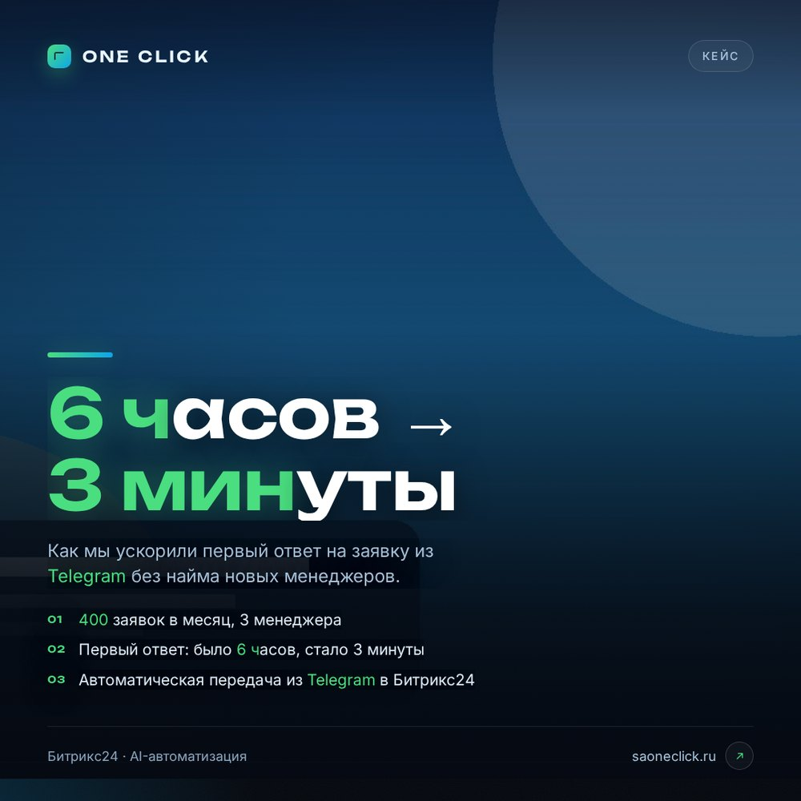
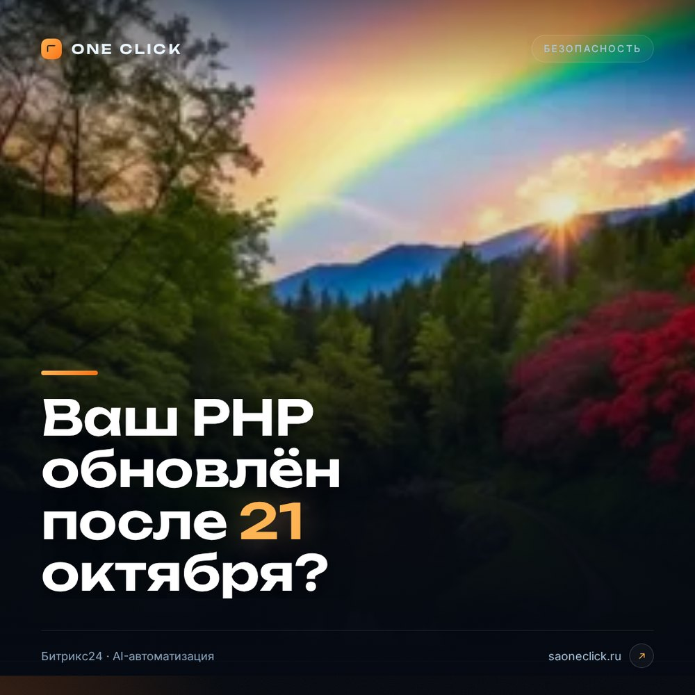
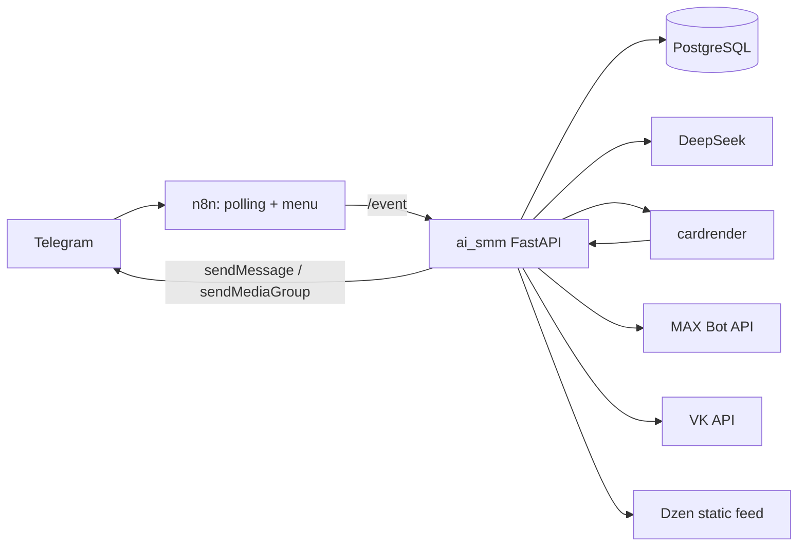

# One Click AI SMM

[](https://github.com/saoneclick/oneclick-ai-smm/actions/workflows/ci.yml)
[](LICENSE)

Личный AI-SMM-специалист в Telegram: собирает бриф, выбирает стратегию, пишет
пост под цель, проверяет себя по чек-листу, готовит карточку и галерею, предлагает
публикацию в Telegram, MAX, VK и Дзен.

Проект вырос из простого генератора карточек: теперь это связка **n8n + Python-сервис
`ai_smm` + `cardrender` + PostgreSQL**, где нейросеть работает не «в один промпт»,
а по редакционному процессу.



## Что умеет

- **Интервью из 7 шагов** — цель, аудитория, тема, факты, формат, CTA, визуал.
  Кнопки, «пропустить», «назад» и редактирование любого поля.
- **Стратегия перед текстом** — угол, инсайт, 3 варианта хука, структура, ключевая
  мысль, доказательства, возражения, визуальное направление.
- **Самокритика по рубрике** — хук, ясность, конкретика, доказательства, эмоция,
  CTA, platform fit, anti-cliché, shareability, visual fit. Слабое переписывается.
- **Несколько фото** — до 10 фото/скриншотов или ссылок. Первое становится
  брендированной обложкой, остальные — галереей.
- **Авто-арт без фото** — `guard`, `terminal`, `chart`, `network`, `grid`, `orbit`.
- **Публикация в Telegram, MAX, VK и Дзен** — после подтверждения, с сохранением
  статуса и ссылок.
- **Тихий тест** — полный прогон без публикации: превью в Telegram + JSON-отчёт.
- **Память и обратная связь** — бриф, стратегия, оценки, действия и причины
  переделок пишутся в PostgreSQL.

## Скриншоты

| Обложка AI-SMM | Security-карточка | Фото-карточка |
|---|---|---|
|  |  |  |

Больше вариантов: [overview.jpg](docs/assets/overview.jpg) и
[photo-overview.jpg](docs/assets/photo-overview.jpg). Сторис — [story.jpg](docs/assets/story.jpg).

## Архитектура



- **n8n** остаётся транспортом и пультом: polling Telegram, меню, старые сценарии.
- **`services/ai_smm`** — весь интеллект: интервью, промпты, стратегия, картинки,
  публикация, планировщик, Dzen.
- **`services/cardrender`** — HTML/CSS/SVG → PNG через Playwright.
- **`services/dzen`** — полная пересборка статического мини-сайта и RSS для Дзена.
- **PostgreSQL** — сессии, брифы, черновики, очередь, обратная связь.

Подробнее: [docs/AI_SMM.md](docs/AI_SMM.md), [docs/PROMPTS.md](docs/PROMPTS.md),
[docs/DEPLOY.md](docs/DEPLOY.md).

## Быстрый старт

```bash
cp infra/.env.example infra/.env
# заполнить токены и доступы
docker compose -f infra/docker-compose.yml up -d --build
```

Сервисы:

| Сервис | Порт | Назначение |
|---|---|---|
| `n8n` | 5678 (через Caddy) | Telegram polling, меню, утверждение |
| `cardrender` | 8000 | рендер карточек |
| `smm` | 8000 | AI-SMM |
| `postgres` | 5432 | память |
| `caddy` | 80/443 | HTTPS и Dzen static |

## Как проходит пост

1. В меню Telegram — **🧠 AI-Маркетолог**.
2. Бот задаёт 7 вопросов. Можно пропустить, вернуться и изменить любое поле.
3. Показывает бриф и каналы. Кнопки каналов переключаются.
4. AI собирает стратегию, текст, самопроверку и карточку.
5. Приходит превью: обложка + галерея + текст + кнопки.
6. **Опубликовать / В очередь / Другой вариант / Изменить бриф / Отмена**.

## Редакционная логика

Вдохновлено классическими фреймворками и современной практикой:

- **Jobs-to-be-Done** — сначала цель читателя и бизнеса, потом формат;
- **AIDA / PAS / STAR / 4U** — разные структуры под охват, боль, кейс и пользу;
- **message-market fit** — один пост = одна мысль и один CTA;
- **self-critique / rubric-based editing** — модель оценивает себя до публикации;
- **anti-AI-cliché** — запрет штампов, канцелярита и выдуманных цифр;
- **accessibility** — alt-текст для изображений;
- **human-in-the-loop** — публикация только после подтверждения.

Подробнее — [docs/PROMPTS.md](docs/PROMPTS.md).

## Тесты

```bash
cd services/ai_smm
pip install -r requirements.txt
pytest -q
```

Тихий тест на сервере:

```bash
curl -X POST http://127.0.0.1:8101/test \
  -H "X-Test-Token: $SMM_TEST_TOKEN"
```

Он делает полный цикл (бриф → стратегия → текст → карточка → превью → Dzen в
temp-каталоге), **не публикует** в каналы и присылает отчёт администратору.

## Безопасность

- Секреты — только в `.env`/`*.local.env`, они в `.gitignore`.
- В публичном репозитории нет токенов, chat_id и ключей.
- Фото из Telegram хранятся в `uploads/` и удаляются после публикации/отмены.
- Dzen-статьи пишутся в смонтированный каталог `dzen/`, Caddy отдаёт их статикой.

## Лицензия

MIT. См. [LICENSE](LICENSE).
